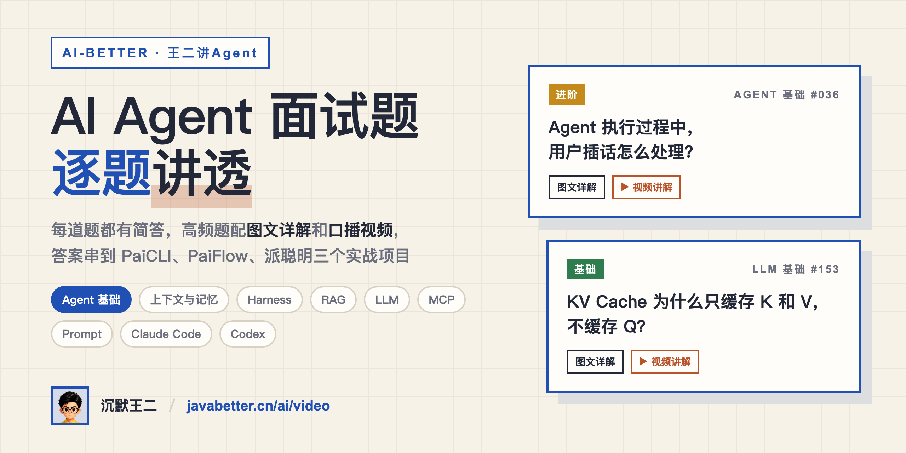

<p align="center">
  <a href="https://javabetter.cn/ai/video/">
    
  </a>
</p>

<!-- AUTO-GENERATED:TITLE:START -->
<h1 align="center">王二讲Agent：AI Agent 面试题 369 道（Agent八股+视频讲解）</h1>
<!-- AUTO-GENERATED:TITLE:END -->

<p align="center">
  <a href="https://javabetter.cn/ai/video/"></a>
  <a href="https://my.feishu.cn/wiki/AcJywdpZ9ioWSOkNTnVcuQ7enMb"></a>
  <a href="https://www.douyin.com/user/MS4wLjABAAAAxdUFFflycLY13_3btQv8eE41gaifL36eotb0FLA7ASOSdwkV8CF89-Wh_L7_Rt1X"></a>
  <a href="https://space.bilibili.com/402000160"></a>
  <a href="#联系方式"></a>
  <a href="https://github.com/itwanger/ai-better"></a>
</p>

## 这是什么

大厂面试里，Agent 相关的题越来越多。「你做过 Agent 项目吗」「RAG 检索怎么做的」「MCP 协议了解吗」，几乎每家都会问。

我把牛客、知识星球和各大厂真实面经里的高频题整理成一套 Agent 八股，按出现频次和难度筛选，随视频更新持续追加。每道题都有简答，高频题配一篇图文详解和一条口播视频。答案不停留在概念上，会串到我自己写的三个实战项目里讲：

- **PaiCLI**，对标 Claude Code 的终端 Agent，[项目介绍](https://javabetter.cn/zhishixingqiu/paicli.html)
- **PaiAgent / PaiFlow**，LangGraph4j + Spring AI 的工作流编排平台，[项目介绍](https://javabetter.cn/zhishixingqiu/paiflow.html)
- **派聪明**，基于 ES 混合检索的 RAG 知识库，[项目介绍](https://javabetter.cn/zhishixingqiu/paismart.html)

这个仓库是这套题的全部原始文件，包括题库、每篇图文的 Markdown，以及每条视频的 Remotion 工程和成片。

## 题库一览

<!-- AUTO-GENERATED:STATS:START -->
| 分类 | 题数 | 图文详解 | 视频讲解 |
| --- | ---: | ---: | ---: |
| 01 Agent 基础 | 43 | 31 | 31 |
| 热点解读 | 11 | 11 | 9 |
| 02 上下文与记忆 | 22 | 9 | 9 |
| 03 Harness 与 Skills | 42 | 3 | 3 |
| 04 RAG知识库 | 43 | 2 | 1 |
| 05 LLM 基础与 API | 82 | 8 | 7 |
| 06 Claude Code与Codex | 17 | 6 | 6 |
| 07 DeepSeek专题 | 5 | 5 | 5 |
| 08 Prompt 工程 | 16 | 2 | 2 |
| 09 MCP 与工具调用 | 26 | 0 | 0 |
| 10 LangChain 与 Spring AI | 21 | 0 | 0 |
| 11 模型训练与微调 | 32 | 1 | 1 |
| 12 Agent 产品与框架演进 | 9 | 1 | 1 |
| **合计** | **369** | **79** | **75** |
<!-- AUTO-GENERATED:STATS:END -->

难度分三级：🟢 基础、🟡 进阶、🔴 深入。推荐到 [javabetter.cn/ai/video](https://javabetter.cn/ai/video/) 在线阅读，有侧边栏目录、站内搜索和内嵌视频，体验比直接看 Markdown 好。想在手机上收藏，可以用同步更新的[飞书知识库](https://my.feishu.cn/wiki/AcJywdpZ9ioWSOkNTnVcuQ7enMb)。

## 题目目录

带链接的题目已经有图文详解，后面的「抖音」「B站」是对应的视频讲解。点开分类查看全部题目。

<!-- AUTO-GENERATED:CATALOG:START -->
<details>
<summary><b>01 Agent 基础</b>（43 题，图文详解 31 篇）</summary>

- 🟡 36. [Agent 执行过程中，用户插话怎么处理？](https://javabetter.cn/ai/video/agent-user-interjection.html) · [抖音](https://www.douyin.com/video/7695711462815223083)
- 🟡 29. [Agent 的幻觉怎么治理？](https://javabetter.cn/ai/video/agent-hallucination-governance.html) · [抖音](https://www.douyin.com/video/7694985391278984486)
- 🟡 28. [Human-in-the-loop 怎么设计？](https://javabetter.cn/ai/video/agent-human-in-the-loop.html) · [抖音](https://www.douyin.com/video/7694555091273010495)
- 🟡 31. [用户中途取消，Agent 任务怎么停下来？](https://javabetter.cn/ai/video/agent-task-cancellation.html) · [抖音](https://www.douyin.com/video/7693089537089604874)
- 🟡 27. [工具调用失败或超时怎么处理？](https://javabetter.cn/ai/video/agent-tool-failure-timeout.html) · [抖音](https://www.douyin.com/video/7692321158200331555)
- 🟡 26. [Agent 的意图路由怎么设计？](https://javabetter.cn/ai/video/agent-intent-routing.html) · [抖音](https://www.douyin.com/video/7691947967841864960)
- 🟡 25. [多 Agent 之间怎么传递上下文？](https://javabetter.cn/ai/video/multi-agent-context-passing.html) · [抖音](https://www.douyin.com/video/7691235788905893158)
- 🟡 24. [Plan 模式已经死了吗？](https://javabetter.cn/ai/video/is-plan-mode-dead.html) · [抖音](https://www.douyin.com/video/7690807740213529882)
- 🟡 23. [Pi Agent 系统里有哪些反复出现的设计模式？](https://javabetter.cn/ai/video/pi-agent-design-patterns.html) · [抖音](https://www.douyin.com/video/7690524611271789850)
- 🟢 22. [如何做出像Pi一样优秀的Agent？](https://javabetter.cn/ai/video/building-effective-agents-principles.html) · [抖音](https://www.douyin.com/video/7690200053318749440)
- 🟡 21. [订机票客服该用工作流还是自主 Agent？](https://javabetter.cn/ai/video/workflow-vs-agent-flight-booking.html) · [抖音](https://www.douyin.com/video/7689782163608194313)
- 🔴 20. [模型越来越强，Harness 会不会被模型「吃掉」？](https://javabetter.cn/ai/video/will-model-eat-harness.html) · [抖音](https://www.douyin.com/video/7689042782064774415)
- 🟡 19. [Agent 的沙箱（Sandbox）你了解吗？](https://javabetter.cn/ai/video/what-is-agent-sandbox.html) · [抖音](https://www.douyin.com/video/7688214970668043539) · [B站](https://www.bilibili.com/video/BV1FBaZ6LEAb/)
- 🟡 18. [了解 Agent 的 Checkpoint 机制吗？](https://javabetter.cn/ai/video/what-is-agent-checkpoint.html) · [抖音](https://www.douyin.com/video/7687551756691098921) · [B站](https://www.bilibili.com/video/BV1qyaZ6gEW2/)
- 🟡 17. [如果只能给 Agent 增加一项能力，更强的 LLM，更长的 Context，还是更多的 Tool？](https://javabetter.cn/ai/video/llm-context-or-tool.html) · [抖音](https://www.douyin.com/video/7687137647629765915) · [B站](https://www.bilibili.com/video/BV1WbaZ6JEpP/)
- 🟢 16. [Harness 的五要素是什么？](https://javabetter.cn/ai/video/harness-five-elements.html) · [抖音](https://www.douyin.com/video/7686445668923231538) · [B站](https://www.bilibili.com/video/BV114aZ6QEwC/)
- 🔴 15. [Multi-Agent 协作时意见冲突怎么办？](https://javabetter.cn/ai/video/multi-agent-conflict-resolution.html) · [抖音](https://www.douyin.com/video/7685693822096985385) · [B站](https://www.bilibili.com/video/BV1hBaL65Edo/)
- 🔴 14. [Agent 怎么做经验积累和自我学习？](https://javabetter.cn/ai/video/how-agent-accumulates-experience.html) · [抖音](https://www.douyin.com/video/7685237612898045190) · [B站](https://www.bilibili.com/video/BV1SThe6sEEW/)
- 🟡 13. [为什么你选择手搓 Agent 而不用框架？](https://javabetter.cn/ai/video/why-handcraft-agent-not-framework.html) · [抖音](https://www.douyin.com/video/7684942306939954856) · [B站](https://www.bilibili.com/video/BV1awhe6ZEVD/)
- 🟡 12. [Agent 的反思机制是什么？为什么需要反思？](https://javabetter.cn/ai/video/what-is-agent-reflection.html) · [抖音](https://www.douyin.com/video/7684519824176712998) · [B站](https://www.bilibili.com/video/BV1Tghe6pEZ3/)
- 🟡 11. [Agent 的 Planning 模块有哪些实现方式？](https://javabetter.cn/ai/video/agent-plan-modes.html) · [抖音](https://www.douyin.com/video/7684156376783899945) · [B站](https://www.bilibili.com/video/BV1Qkhe6hE2U/)
- 🟡 4. [说说 Agent 是如何工作的？](https://javabetter.cn/ai/video/how-agent-works.html) · [抖音](https://www.douyin.com/video/7659293535715298587) · [B站](https://www.bilibili.com/video/BV1C6TX63EQK/)
- 🟢 5. [一个 Agent 有哪些核心组件？](https://javabetter.cn/ai/video/agent-core-components.html) · [抖音](https://www.douyin.com/video/7658925498893929769) · [B站](https://www.bilibili.com/video/BV1PmMM6QEhe/)
- 🟡 7. [到底什么是 ReAct？和 CoT 有什么区别？](https://javabetter.cn/ai/video/what-is-react.html) · [抖音](https://www.douyin.com/video/7658189484642651426) · [B站](https://www.bilibili.com/video/BV1BFTx69EBT/)
- 🟢 3. [Workflow 和 Agent 有什么区别？](https://javabetter.cn/ai/video/workflow-vs-agent.html) · [抖音](https://www.douyin.com/video/7657820250913639730) · [B站](https://www.bilibili.com/video/BV1cHT76qEtr/)
- 🟢 2. [Agent 和 ChatBot 最大的区别是什么？](https://javabetter.cn/ai/video/agent-chatbot-difference.html) · [抖音](https://www.douyin.com/video/7657431432612039982) · [B站](https://www.bilibili.com/video/BV1qqTY6rEPc/)
- 🟢 1. [什么是 Agent？和直接调大模型 API 有什么本质区别？](https://javabetter.cn/ai/video/what-is-agent.html) · [抖音](https://www.douyin.com/video/7656663165568044324) · [B站](https://www.bilibili.com/video/BV13dT562Eqr/)
- 🟡 10. [Multi-Agent 协作是怎么实现的？](https://javabetter.cn/ai/video/multi-agent-collaboration.html) · [抖音](https://www.douyin.com/video/7656328223348821248) · [B站](https://www.bilibili.com/video/BV1AjTK6GE6z/)
- 🟡 9. [什么是 Plan-and-Execute？](https://javabetter.cn/ai/video/plan-and-execute.html) · [抖音](https://www.douyin.com/video/7655306519898017074) · [B站](https://www.bilibili.com/video/BV1xy7a65EA1/)
- 8. [ReAct 会死循环吗？](https://javabetter.cn/ai/video/react-death-loop.html) · [抖音](https://www.douyin.com/video/7655196193752010027) · [B站](https://www.bilibili.com/video/BV1g8jZ6dEWV/)
- 6. [Agent 怎么知道该调用哪个工具？](https://javabetter.cn/ai/video/agent-hnow-tool-call.html) · [抖音](https://www.douyin.com/video/7654443885439094042) · [B站](https://www.bilibili.com/video/BV1m9j16DEmv/)
- 🟢 30. Tool 的设计原则是什么？
- 🟢 32. 用户需求模糊时 Agent 怎么澄清？
- 🟡 33. Agent 执行跑偏怎么拉回来？
- 🔴 34. 多个 Agent 同时改一个文件怎么办？
- 🟡 35. 权限模式（Permission Mode）是什么？
- 🟢 37. Agent 的 Todo List 有什么用？
- 🔴 38. Durable Execution 和 Checkpoint 有什么区别？
- 🟡 39. Handoff 和把 Agent 当作工具调用有什么区别？
- 🟡 40. Agent 的凭证怎么管理？
- 🟢 41. 什么是 Agent 的 Headless 模式？
- 🟡 42. Agent Framework、Runtime、Harness 有什么区别？
- 🟡 43. Computer Use 是什么？说说它的原理

</details>

<details>
<summary><b>热点解读</b>（11 题，图文详解 11 篇）</summary>

- [REA 保姆级教程：DeepSeek Harness 实操](https://javabetter.cn/ai/video/rea-deepseek-harness-tutorial.html) · [抖音](https://www.douyin.com/video/7696102369058196736)
- [最近爆火的 Personal Agent 到底是什么？](https://javabetter.cn/ai/video/what-is-personal-agent.html) · [抖音](https://www.douyin.com/video/7695348838801886499)
- [Claude Haiku 5.5 怎么在成本和智能之间做选择？](https://javabetter.cn/ai/video/claude-haiku-5-5.html) · [抖音](https://www.douyin.com/video/7694223913370258729)
- [CPU、GPU、NPU 到底有什么区别？](https://javabetter.cn/ai/video/cpu-gpu-npu-difference.html) · [抖音](https://www.douyin.com/video/7693854535088868643)
- [Kolibri 如何蒸馏 GLM-5.3 和 Qwen3.8？](https://javabetter.cn/ai/video/aleph-alpha-kolibri.html) · [抖音](https://www.douyin.com/video/7693484001561972019)
- [Gemini 4 Argon 发布，100 万 Token 输出意味着什么？](https://javabetter.cn/ai/video/gemini-4-argon.html) · [抖音](https://www.douyin.com/video/7691703611381894415)
- [MiMo-V3 的 HySparse2 和混合滑动窗口注意力有什么区别？](https://javabetter.cn/ai/video/mimo-v3-hysparse2.html) · [抖音](https://www.douyin.com/video/7689435090677402895)
- [推荐 5 个复刻 Jev 的开源项目](https://javabetter.cn/ai/video/open-source-jev-replicas.html) · [抖音](https://www.douyin.com/video/7688302955489021238) · [B站](https://www.bilibili.com/video/BV1zzaZ6CEbM/)
- [不生成文本的 Jev，为什么让 14 万开发者排队？](https://javabetter.cn/ai/video/what-is-jev.html) · [抖音](https://www.douyin.com/video/7687944233659026722) · [B站](https://www.bilibili.com/video/BV1eUaZ6qEDR/)
- [GPT-6 Astra 全量上线，为什么 OpenAI 敢说 AGI 时代来了？](https://javabetter.cn/ai/video/gpt-6-astra.html)
- [Claude、ChatGPT、Grok 全崩，你的中转为什么还能用？](https://javabetter.cn/ai/video/why-relay-still-works.html)

</details>

<details>
<summary><b>02 上下文与记忆</b>（22 题，图文详解 9 篇）</summary>

- 52. [Agent 的长期记忆怎么实现？](https://javabetter.cn/ai/video/agent-long-term-memory.html) · [抖音](https://www.douyin.com/video/7667739270735514930) · [B站](https://www.bilibili.com/video/BV1yR3k6REFM/)
- 48. [为什么聊着聊着 Agent 就变笨了？](https://javabetter.cn/ai/video/why-agent-gets-dumber.html) · [抖音](https://www.douyin.com/video/7666746723645148442) · [B站](https://www.bilibili.com/video/BV1TH3j6pEno/)
- 51. [Agent 的短期记忆怎么实现？](https://javabetter.cn/ai/video/agent-short-term-memory.html) · [抖音](https://www.douyin.com/video/7663725283039563044) · [B站](https://www.bilibili.com/video/BV1fGKA6pEcv/)
- 50. [怎么让 Agent 拥有记忆？](https://javabetter.cn/ai/video/how-to-give-agent-memory.html) · [抖音](https://www.douyin.com/video/7663380317411003690) · [B站](https://www.bilibili.com/video/BV1bWKH6ZE9J/)
- 45. [Agent 的上下文窗口是什么？](https://javabetter.cn/ai/video/what-is-context-window.html) · [抖音](https://www.douyin.com/video/7663057047717547283) · [B站](https://www.bilibili.com/video/BV1oGKG65E6G/)
- 49. [为什么说 LLM 本身没有记忆？](https://javabetter.cn/ai/video/why-llm-has-no-memory.html) · [抖音](https://www.douyin.com/video/7662685584615427371)
- 44. [什么是上下文工程（Context Engineering）？](https://javabetter.cn/ai/video/what-is-context-engineering.html) · [抖音](https://www.douyin.com/video/7660389232246050083) · [B站](https://www.bilibili.com/video/BV1RHM768EjW/)
- 46. [为什么 LLM 的上下文窗口不能无限大？](https://javabetter.cn/ai/video/context-window-limit.html) · [抖音](https://www.douyin.com/video/7660013204101254406) · [B站](https://www.bilibili.com/video/BV1UbMi6BEet/)
- 47. [Agent 怎么避免上下文爆炸？](https://javabetter.cn/ai/video/agent-context-explosion.html) · [抖音](https://www.douyin.com/video/7659664856261348642) · [B站](https://www.bilibili.com/video/BV1oqMt6FEEH/)
- 🟡 53. 为什么不能在系统提示词里放时间戳？
- 🟡 54. 滑动窗口对话历史有什么问题？
- 🔴 55. 什么是 Agent 状态栏？
- 🔴 56. 上下文压缩会不会和 KV Cache 冲突？
- 🟡 57. 为什么说隔离优于压缩？
- 🟡 58. 用户记忆有哪几种存储格式？
- 🔴 59. 用户前后给了矛盾的信息，记忆系统怎么处理？
- 🟡 60. Agent 记忆压缩通常有哪些方法？
- 🔴 61. 长期记忆的 FIFO 淘汰有什么问题？怎么优化？
- 🟡 62. 长上下文压缩有哪些方案？
- 🟡 63. 同一个用户在私聊和群组里和 Agent 对话，应该共享会话还是隔离？OpenClaw 是怎么设计会话隔离粒度的？
- 🟡 64. Agent 的短期记忆和长期记忆分别怎么实现？
- 🔴 65. LLaMA 模型中，输入句子的长度理论上是否可以无限长？

</details>

<details>
<summary><b>03 Harness 与 Skills</b>（42 题，图文详解 3 篇）</summary>

- 67. [什么是 Loop Engineering？](https://javabetter.cn/ai/video/what-is-loop-engineering.html) · [抖音](https://www.douyin.com/video/7662238546815634729) · [B站](https://www.bilibili.com/video/BV1q5NQ6pEPg/)
- 66. [什么是 Harness Engineering？](https://javabetter.cn/ai/video/what-is-harness-engineering.html) · [抖音](https://www.douyin.com/video/7661856429820661007) · [B站](https://www.bilibili.com/video/BV185NC6nEho/)
- 68. [Agent 挂了几十个 Skill，怎么保证命中率？](https://javabetter.cn/ai/video/agent-skill-hit-rate.html) · [抖音](https://www.douyin.com/video/7654468095473356070) · [B站](https://www.bilibili.com/video/BV1Lfjy6bEKY/)
- 🔴 69. Skill 正文是怎么进入上下文的？
- 🟡 70. 一份可用的 Skill 应该包含哪几部分？
- 🔴 71. 工具的风险等级怎么按参数动态判断？
- 🟡 72. 需要人工确认但用户不在线，Agent 该怎么办？
- 🔴 73. Pass@k 和 Pass^k 有什么区别？
- 🟡 74. LLM-as-a-Judge 有什么已知偏差？
- 🔴 75. Agent 的失败轨迹怎么做归因？
- 🔴 76. 评估分差 3 个点，能据此切换模型吗？
- 🟡 77. 多轮工具调用，怎么判断该继续调用还是该停？
- 🟡 78. Token 预算管理怎么做？
- 🟡 79. 大模型部署有哪些主流方案？vLLM、TGI、llama.cpp 怎么选？
- 🟡 80. 有没有用过大模型网关框架？网关层解决了什么问题？
- 🟡 81. Agent 系统从 demo 到生产级落地要走哪些流程？
- 🔴 82. Agent 的执行效果怎么评估？
- 🟡 83. 大模型能力评测指标有哪些？
- 🟡 84. Agent 响应太慢怎么优化？
- 🔴 85. Agent 系统有哪些安全风险？怎么防范？
- 🟡 86. Skill 预置知识包机制是什么？怎么设计的？
- 🔴 87. 多工具调度引擎怎么设计？工具之间有依赖怎么处理？
- 🟡 88. Agent 流式输出怎么设计？怎么提升用户体验？
- 🟡 89. Agent 系统的可观测性怎么做？需要监控哪些指标？
- 🟡 90. Agent 灰度发布怎么做？
- 🟡 91. Agent 系统的成本怎么控制？
- 🟡 92. Agent 系统怎么做容错？单点故障怎么处理？
- 🟡 93. 数据标注在 Agent 项目中有多重要？怎么做？
- 🟡 94. Agent 项目如何处理合规与用户隐私？
- 🔴 95. 你在 Agent 项目中遇到的最大技术挑战是什么？
- 🟢 96. 什么是护栏技术？
- 🟡 97. OpenClaw 的核心组件有哪些？请描述它们之间的关系
- 🟢 98. 如果一个 Agent 系统要同时接入 Web、飞书、钉钉等渠道，你会怎么设计渠道抽象层？OpenClaw 的 Channel Plugin 接口是怎么设计的？
- 🟡 99. 如何设计和管理 AI Agent 的 Skills 体系？在实际项目中有哪些挑战？
- 🟡 100. 同一个系统里可能有多个 Agent，不同渠道用户群组的消息需要路由到不同的 Agent。你会怎么设计这个路由？OpenClaw 的路由匹配优先级是怎样的？
- 🟡 101. 同一个工具（比如「执行命令」）在不同场景下应该有不同的权限。你会怎么设计工具的权限控制？OpenClaw 的工具策略管道是怎么分层的？
- 🟡 102. Agent 系统中 Hook 中间件模式有什么用？能举几个典型场景吗？OpenClaw 的 Hook 系统是怎么设计的？
- 🟡 103. 父 Agent spawn 子 Agent 时，有哪些边界问题需要考虑？OpenClaw 做了哪些限制和保护？
- 🟡 104. OpenClaw 采用插件架构，第三方可以注册新渠道、工具、Hook。设计一个插件系统需要考虑哪些关键问题？OpenClaw 的插件 API 长什么样？
- 🟡 105. OpenClaw 的 Gateway 对 Agent 请求做了幂等性处理。为什么 Agent 系统特别需要幂等性？工具已经产生副作用时怎么办？
- 🟡 106. 如果一个GPU集群的LLM处理能力为1000tokenss，那1000个用户同时并发访问，响应给每个用户的性能只有1 tokens吗？怎么分析性能瓶颈
- 🟢 107. 什么是 AI 编程中的自动修复循环（Auto-fix Loop）？它的工作流程和退出策略怎么设计？

</details>

<details>
<summary><b>04 RAG知识库</b>（43 题，图文详解 2 篇）</summary>

- 108. [Agent 的 RAG 遇到 PDF 怎么办？](https://javabetter.cn/ai/video/agent-rag-pdf.html) · [抖音](https://www.douyin.com/video/7657063729804152074) · [B站](https://www.bilibili.com/video/BV1FSKZ62ETR/)
- 🔴 109. RAPTOR 和 GraphRAG 分别擅长什么查询？
- 🟡 110. 什么是知识库的文件系统范式？
- 🟡 111. 什么是上下文感知检索（Contextual Retrieval）？
- 🟢 112. 为什么需要 RAG？直接把文档塞给大模型不行吗？
- 🟢 113. RAG 和微调怎么选？各自适合什么场景？
- 🟢 114. 描述一下完整的 RAG 系统工作流程？
- 🟡 115. 文档分块策略怎么设计？chunk 大小怎么定？
- 🟡 116. 怎么规避语义被切割掉的问题？
- 🟡 117. Embedding 模型怎么选型？维度越高越好吗？
- 🟡 118. Embedding 有哪几种算法？各自的特点是什么？
- 🟡 119. 向量数据库怎么选型？你们项目用的哪个？
- 🟡 120. [RAG 怎么做向量和关键词的混合检索？](https://javabetter.cn/ai/video/rag-hybrid-search.html)
- 🟡 121. 什么是 Query Rewrite？为什么需要改写用户查询？
- 🟡 122. 什么是多路召回？具体怎么做？
- 🟡 123. 为什么检索之后还需要 Rerank？
- 🟡 124. Rerank 的 Top-K 怎么确定？
- 🟡 125. RAG 系统怎么评测？核心指标有哪些？
- 🟡 126. 向量数据库里的历史文档怎么做时间衰减？
- 🔴 127. 在什么场景下会用图数据库来增强向量检索？
- 🟡 128. Agentic RAG 和传统 RAG 的核心区别？
- 🟡 129. 处理长文档时怎么避免 OOM？
- 🟡 130. RAG 知识库怎么实现动态更新？
- 🟡 131. 多租户场景下 RAG 的权限隔离怎么做？
- 🟡 132. 在 RAG 应用中为了优化检索精度，其中的数据清洗和预处理怎么做？
- 🟢 133. 什么自查询？为什么在 RAG 中需要自查询？
- 🟢 134. 什么提示压缩？为什么在 RAG 中需要提示压缩？
- 🟡 135. 在 RAG 中，索引流程中的文档解析你们怎么做的？
- 🟡 136. 向量数据库中的 HNSW、LSH、PQ 分别是什么意思？
- 🟡 137. 向量数据库中的 ANN 是什么？为什么需要用它？
- 🟡 138. 向量数据库中，常见的向量搜索方法：余弦相似度、欧几里得距离和曼哈顿距离分别是什么？有什么区别？
- 🟡 139. 什么是 Advanced RAG？
- 🟡 140. 什么是 Modular RAG？
- 🟡 141. 什么是上下文查询增强？它有什么作用？如何基于 Spring AI 实现上下文查询增强来处理无关问题？
- 🟡 142. 什么是 Spring AI 提出的模块化 RAG 架构？预检索、检索和后检索阶段各自负责什么？
- 🟡 143. 你有多个知识库，做 RAG 的时候，怎么保证查询效率和准确性兼容，并尽可能减少幻觉？
- 🟡 144. 如何构建和使用向量索引？HNSW 和 IVF 有什么区别？
- 🟡 145. RAG 检索时相似度阈值如何设置？设置不当有什么影响？
- 🟡 146. RAG 系统如何利用元数据过滤提升检索精度？
- 🟡 147. 如何处理 RAG 检索不到相关文档的情况？
- 🟡 148. RAG 系统如何标注信息来源和提供引用？
- 🔴 149. RAG 系统在生产环境中如何优化性能和降低成本？
- 🟡 150. RAG 系统如何处理 PDF、Word、Markdown 等不同格式文档？

</details>

<details>
<summary><b>05 LLM 基础与 API</b>（82 题，图文详解 8 篇）</summary>

- 155. [DeepSeek 的 Prompt Caching 为什么能全自动生效，Claude 为什么要手动加 cache_control？](https://javabetter.cn/ai/video/what-is-prompt-caching.html) · [抖音](https://www.douyin.com/video/7683417600369397033) · [B站](https://www.bilibili.com/video/BV1dYeE6wEAE/)
- 154. [Prefix Caching（前缀缓存）是什么？和 KV Cache 是什么关系？](https://javabetter.cn/ai/video/what-is-prefix-caching.html) · [抖音](https://www.douyin.com/video/7683112468356386063) · [B站](https://www.bilibili.com/video/BV1PmY66uEpN/)
- 153. [KV Cache 是什么？为什么只缓存 K 和 V，不缓存 Q？](https://javabetter.cn/ai/video/what-is-kv-cache.html) · [抖音](https://www.douyin.com/video/7682646844794539298) · [B站](https://www.bilibili.com/video/BV1nJYY65E6y/)
- 157. [什么是线性注意力？GLM-5.3-Flash 为什么采用线性注意力加稀疏注意力的混合架构？](https://javabetter.cn/ai/video/glm-flash-linear-sparse-attention.html) · [抖音](https://www.douyin.com/video/7681542417195011366) · [B站](https://www.bilibili.com/video/BV1QrY26iE8X/)
- 151. [Responses API 和 Chat Completions API 有什么区别？](https://javabetter.cn/ai/video/responses-api-vs-chat-completions.html) · [抖音](https://www.douyin.com/video/7675690881772506414) · [B站](https://www.bilibili.com/video/BV11H8n6CEBs/)
- 152. [大模型 API 缓存命中和未命中为什么差价巨大？](https://javabetter.cn/ai/video/api-cache-hit-miss.html) · [抖音](https://www.douyin.com/video/7672403032797154601) · [B站](https://www.bilibili.com/video/BV1WAuZ6fEXP/)
- 156. [MoE 是什么？DeepSeek 模型为什么采用混合专家架构？](https://javabetter.cn/ai/video/what-is-moe.html) · [抖音](https://www.douyin.com/video/7670768776341753122) · [B站](https://www.bilibili.com/video/BV1EKuJ6VEkc/)
- 158. [SWE-bench、Terminal-Bench、GPQA Diamond 这些大模型评测集到底在测什么？](https://javabetter.cn/ai/video/what-benchmarks-test.html)
- 🟢 159. 什么是大语言模型？和传统 NLP 模型有什么区别？
- 🟢 160. 讲讲 Transformer 的基本架构？Encoder 和 Decoder 分别干什么？
- 🟡 161. 多头注意力（MHA）有哪些局限？MQA、GQA、Flash Attention 怎么解决？
- 🟡 162. 位置编码是干什么用的？RoPE 和 ALiBi 有什么区别？
- 🟡 163. 分词器是什么？BPE、WordPiece、SentencePiece 有什么区别？
- 🟡 164. 什么是 Scaling Law？大模型的涌现能力是怎么回事？
- 🟡 165. 大模型生成文本时有哪些解码策略？
- 🟡 166. Temperature、Top-P、Top-K 分别是什么？怎么调？
- 🟡 167. 大模型幻觉问题怎么减少？
- 🟡 168. 什么是 CoT（思维链）？为什么效果好？有什么局限？
- 🟡 169. 多模型动态切换怎么实现？不重启服务就能换？
- 🟡 170. OpenAI 兼容协议是什么？各家大模型的差异在哪？
- 🟡 171. 流式输出（SSE / WebSocket）怎么设计？
- 🟡 172. 对比使用过哪些主流大模型？你们项目里最终选了哪个？
- 173. 怎么让 LLM 返回结构化内容，比如和 Java 对象字段一一对应？
- 174. LLM 返回的内容被截断了怎么办？
- 🟡 175. Chat Template 是什么？
- 🔴 176. 多轮工具调用时，历史的 reasoning 要不要回传给模型？
- 🟡 177. 给 Agent 选模型要看哪些维度？
- 🟡 178. 什么是词嵌入（Word Embedding）？有哪些常见的词嵌入方法？
- 🔴 179. 是否使用 Word2Vec 训练过数据？在这个过程中，如何获取语料？如何选择超参数？语料、词表和维度大小如何确定？怎样把握训练时长？
- 🔴 180. Word2Vec 有哪些加速方法？
- 🔴 181. 解释 hierarchical softmax 的流程，以及它有什么优点？
- 🟡 182. 说一说负采样技术在 Word2Vec 中的运用。
- 🟡 183. CBOW 和 Skip-gram 分别更适合哪些应用场景？
- 🔴 184. 说说 GloVE 技术，怎样进行训练？有哪些应用场景？相比 Word2Vec 有哪些优缺点？
- 🔴 185. 说说 FastText 技术，是否比 Word2Vec 更优越？哪些情况下更适合使用 FastText
- 🔴 186. 聊一聊 ELMo 技术，它有哪些优缺点？可以做到一词多义吗？为什么？
- 🟢 187. 说说 LSTM 的基本原理。
- 🟡 188. 与循环神经网络（RNN）相比，LSTM 是如何解决梯度消失问题的？
- 🟡 189. 解释一个 LSTM 单元（LSTM cell）的基本组成，以及它们各自的作用。
- 🟡 190. LSTM 中，隐藏状态（hidden state）和单元状态（cell state）有什么区别？
- 🟡 191. LSTM 和 GRU 有什么区别？
- 🟡 192. 请描述 BERT 模型的架构和应用场景。
- 🟡 193. BERT 是如何处理自然语言文本中不常见词或者罕见词的？
- 🟡 194. Word2Vec 到 BERT 有怎样的改进？
- 🟡 195. BERT 怎样进行 mask 相比 CBOW 有什么区别？
- 🔴 196. 你有什么办法可以比较好地解决 BERT 输入长度的限制？
- 🔴 197. 说说你是怎样有效地优化和微调 BERT，以应对你做过的一些特定的 NLP 任务的？
- 🟢 198. 如何比较文本的相似度？
- 🟢 199. 支持向量机可以用于文本分类任务吗？若可以，请说明。
- 🟡 200. 在文本分类任务中，如何处理高维和稀疏数据？
- 🟡 201. 在文本分类任务中，如何处理样本（类别）不平衡的问题？
- 🟡 202. 现有文本分类算法在处理多语种文本数据时可能遭遇哪些挑战？
- 🟡 203. 简述 Word Embedding 可以怎样运用于文本分类任务？
- 🟡 204. 简述 LLaMA（Large Language Model Meta AI）的基本原理。
- 🟢 205. LLaMA 有哪些实际应用？
- 🟡 206. Transformer 在计算 attention 的时候使用的是点乘还是加法？请说明理由。
- 🟢 207. self attention 中的 K 和 Q 是用来做什么的？
- 🟡 208. K 和 Q 可以使用同一个值通过对自身进行点乘得到吗？
- 🔴 209. 如果让 K 和 Q 变成同一个矩阵，你觉得对模型性能会带来怎样的影响？
- 🟡 210. 在不考虑计算量的情况下，head 能否无限增多？
- 🟡 211. 在进行多头注意力的时候需要对每个 head 进行降维吗？
- 🟡 212. 讲一下你对 Transformer 的 Encoder 模块的理解。
- 🟡 213. Transformer 中，Decoder 阶段的多头自注意力和 Encoder 阶段的多头自注意力是相同的吗？
- 🟡 214. 了解 Transformer 模型训练中的梯度裁剪（Gradient Clipping）吗？
- 🟡 215. Transformer 为什么采用 Layer Normalization 而不是 Batch Normalization
- 🟡 216. Transformer 中的注意力遮蔽（Attention Masking）的工作原理是什么？
- 🟡 217. 什么是自回归属性（autoregressive property）？
- 🟡 218. Transformer 中的“残差连接”可以缓解梯度消失问题吗？
- 🟡 219. Transformer 中，如何处理大型数据集？
- 🟡 220. Transformer 模型训练完成后，如何评估其性能和效果？
- 🟡 221. Transformer 模型的性能瓶颈在哪？
- 🔴 222. 你觉得可以怎样缓解这个性能瓶颈？
- 🟡 223. 了解 ViT（Vision Transformer） 吗？
- 🔴 224. 了解 ViLT（Vision-and-Language Transformer） 吗？
- 🟡 225. ViLT 模型是如何将 Transformer 应用于图像识别任务的
- 🟡 226. chatGLM 和 GPT 在结构上有什么区别？
- 🟢 227. 什么是 GPT Structured Outputs？
- 🟢 228. 什么是 GPTCache？
- 🟢 229. 大模型的 Token 是什么？输入 Token 和输出 Token 在计费上有什么区别？
- 🟡 230. MoE 混合专家模型是什么？DeepSeek、Qwen 为什么用 MoE？
- 🟢 231. 什么是 Token 缓存机制？它如何帮助降低 AI 应用的成本？
- 🟡 232. KV Cache 是什么？Prompt Caching 又是什么？

</details>

<details>
<summary><b>06 Claude Code与Codex</b>（17 题，图文详解 6 篇）</summary>

- 238. [Codex 的长期记忆是怎么实现的？](https://javabetter.cn/ai/video/codex-long-term-memory.html) · [抖音](https://www.douyin.com/video/7678302786009746734) · [B站](https://www.bilibili.com/video/BV1A34U65ED6/)
- 235. [Claude Code 如何检索长期记忆？](https://javabetter.cn/ai/video/claude-code-memory-retrieval.html) · [抖音](https://www.douyin.com/video/7673366479827504384) · [B站](https://www.bilibili.com/video/BV1C8gH6tE5B/)
- 236. [CLAUDE.md 到底要怎么写才有用？](https://javabetter.cn/ai/video/how-to-write-claudemd.html) · [抖音](https://www.douyin.com/video/7669281306200165659) · [B站](https://www.bilibili.com/video/BV1Z13X6rEk5/)
- 234. [Claude Code 的长期记忆是怎么实现的？](https://javabetter.cn/ai/video/claude-code-long-term-memory.html) · [抖音](https://www.douyin.com/video/7668673990940003625) · [B站](https://www.bilibili.com/video/BV18wGN68E3Q/)
- 237. [Codex 的短期记忆是怎么实现的？](https://javabetter.cn/ai/video/codex-short-term-memory.html) · [抖音](https://www.douyin.com/video/7665302340374629675) · [B站](https://www.bilibili.com/video/BV1QnKY6bELM/)
- 233. [Claude Code 的短期记忆是怎么实现的？](https://javabetter.cn/ai/video/claude-code-short-term-memory.html) · [抖音](https://www.douyin.com/video/7664489707128016134) · [B站](https://www.bilibili.com/video/BV1XrK16YEWe/)
- 🟡 239. AI 辅助编程在实际工作中怎么提效的？
- 🟡 240. 代码生成场景下 AST 分析有什么用？
- 🟡 241. LSP 诊断注入在 AI Coding 中解决什么问题？
- 🟡 242. 怎么保障 AI 改代码的安全性？Git 快照回滚怎么做？
- 🟡 243. 代码库的向量化和语义搜索怎么做？
- 🟡 244. AI 代码审查和人工代码审查有什么互补关系？
- 🟡 245. 多文件编辑时上下文怎么管理？
- 🟡 246. CLI 形态的 AI Agent 和 IDE 插件形态有什么优劣？
- 🟢 247. 什么是 Agentic Engineering？它和 Vibe Coding 有什么区别？
- 🟢 248. 什么是深度思考（Deep Thinking）和自适应思考（Adaptive Thinking）？它们在 AI 编程中有什么应用？
- 🟢 249. 什么是 Background Agent（后台 Agent）？它改变了 AI 编程的什么工作方式？

</details>

<details>
<summary><b>07 DeepSeek专题</b>（5 题，图文详解 5 篇）</summary>

- 254. [多模态模型和纯文本模型有什么区别？以 DeepSeek V4-Flash-Vision-Exp 为例](https://javabetter.cn/ai/video/deepseek-multimodal.html) · [抖音](https://www.douyin.com/video/7680432993629949220) · [B站](https://www.bilibili.com/video/BV1nPYs6pEYU/)
- 251. [CSA、HCA 与 KV Cache：DeepSeek V4 缓存为什么更便宜？](https://javabetter.cn/ai/video/v4-csa-hca-kv-cache.html) · [抖音](https://www.douyin.com/video/7679479739840466202) · [B站](https://www.bilibili.com/video/BV1d5tq6vEeE/)
- 252. [DeepSeek V4 为什么用 CSA 和 HCA 替换 MLA？](https://javabetter.cn/ai/video/v4-why-replace-mla.html) · [抖音](https://www.douyin.com/video/7678962200215571731) · [B站](https://www.bilibili.com/video/BV1Y3tg6XEbT/)
- 253. [Cordis 是什么？DeepSeek Harness 的插件系统如何理解？](https://javabetter.cn/ai/video/what-is-cordis.html) · [抖音](https://www.douyin.com/video/7674857729629900038) · [B站](https://www.bilibili.com/video/BV1h1bY6QEWF/)
- 250. [为什么更小的激活参数也能获得更强 Agent 能力？](https://javabetter.cn/ai/video/why-post-training-beats-params.html) · [抖音](https://www.douyin.com/video/7670027713771621658) · [B站](https://www.bilibili.com/video/BV1K7uF6PEKD/)

</details>

<details>
<summary><b>08 Prompt 工程</b>（16 题，图文详解 2 篇）</summary>

- 🟡 270. [如何写好 Prompt？分享下 Prompt 工程的实践经验？](https://javabetter.cn/ai/video/nine-prompting-techniques-for-better-llm.html) · [抖音](https://www.douyin.com/video/7692668076902468879)
- 255. [什么是提示词工程（Prompt Engineering）？](https://javabetter.cn/ai/video/what-is-prompt-engineering.html) · [抖音](https://www.douyin.com/video/7660769784925097231) · [B站](https://www.bilibili.com/video/BV1zhNE6aEGH/)
- 🟡 256. 系统提示词是流程驱动好还是规则堆砌好？
- 🟡 257. 系统提示词怎么防止越写越乱？
- 🟢 258. 提示词中的分隔符有什么作用？如何使用？
- 🟢 259. 什么是系统提示词 System Prompt？它和用户提示词有什么区别？
- 🟡 260. 什么是 Few-shot Learning？Zero-shot、One-shot、Few-shot 有什么区别？
- 🟡 261. 如何选择和设计 Few-shot 示例以提升效果？
- 🟡 262. 什么是自洽性？如何应用？
- 🟡 263. 什么是负面提示词？在什么场景下使用？
- 🟡 264. 什么是提示词链接？如何实现？
- 🟡 265. 如何为不同领域设计专用提示词？比如编程、创作、数据分析
- 🔴 266. 如何系统地评估和优化提示词的效果？
- 🔴 267. 提示词注入攻击是什么？如何防范？
- 🔴 268. 在实际项目中如何进行提示词的 AB 测试和迭代？
- 🔴 269. 什么是思维树 Tree of Thoughts？它相比 CoT 有什么优势？

</details>

<details>
<summary><b>09 MCP 与工具调用</b>（26 题，图文详解 0 篇）</summary>

- 🟡 271. Function Calling 底层是怎么实现的？
- 🟡 272. LLM 是如何学会调用外部工具的？Function Call 能力怎么训练？
- 🟡 273. MCP 是什么？它解决了什么问题？
- 🟡 274. MCP 由哪几部分组成？
- 🟡 275. MCP 和 Function Calling 有什么区别？
- 🟡 276. Function Calling、Skill、MCP 三者有什么区别？
- 🟡 277. MCP Server 的 stdio 和 HTTP 模式分别怎么用？
- 🟡 278. 为什么有些推理模型不支持 MCP？
- 🟡 279. 什么是 A2A 协议？和 MCP 有什么区别？
- 🟡 280. WebSocket 和 SSE 通信有什么区别？在 AI 场景中各自怎么用？
- 🟡 281. 工具描述（Tool Description）怎么写才能让模型准确调用？
- 🟡 282. 敏感工具的安全控制怎么做？
- 🟡 283. 模型编造不存在的工具调用（工具幻觉）怎么防？
- 🟢 284. 在 Spring AI 框架中如何集成 MCP？
- 🟢 285. MCP 协议安全性设计包含哪些层面？
- 🟢 286. 如何将已有的应用转换成 MCP 服务？
- 🟡 287. 什么是 A2A 协议，它的核心架构及主要组件有哪些？
- 🟡 288. A2A 协议有哪五大设计原则？
- 🟢 289. MCP 和 Skills 有什么区别？分别适用于什么场景？
- 🟡 290. 不同的 LLM Provider 对 Tool Schema 的支持不完全一致，你会怎么处理这种差异？OpenClaw 是怎么做 Schema 适配的？
- 🟢 291. 什么是 ACP 协议？它有哪两个不同的含义？
- 🟢 292. Agent 的工具分哪几类？
- 🟡 293. 一项能力该做成专用工具、通用执行器还是 Skill？
- 🔴 294. 什么是工具参数的静默转换？
- 🔴 295. Agent 有上百个工具时怎么办？
- 🟡 296. 多个 MCP 服务器有功能重叠的工具，怎么选？

</details>

<details>
<summary><b>10 LangChain 与 Spring AI</b>（21 题，图文详解 0 篇）</summary>

- 🟢 297. 什么是 LangGraph ？
- 🟢 298. LangGraph 编排的原理是什么？
- 🟢 299. ​LangChain 和 LangGraph 有什么区别？
- 🔴 300. LlamaIndex 如何与 LangChain 结合？
- 🟢 301. 什么是 Spring AI 框架？它有哪些核心特性？
- 🟡 302. 什么是结构化输出？Spring AI 是怎么实现结构化输出的？
- 🟡 303. 什么是 Re-Reading？如何基于 Spring AI 实现 Re-Reading Advisor？
- 🟡 304. 什么是工具调用 Tool Calling？如何利用 Spring AI 实现工具调用？
- 🟢 305. LangChain 中的 Chain 是什么？有哪些常见类型？
- 🟡 306. LangChain 的 Memory 组件有什么作用？常见的 Memory 类型有哪些？
- 🟡 307. 在 LangChain 中如何实现流式输出？
- 🟡 308. 如何在 LangChain 中自定义 Tool 工具？
- 🟡 309. LangChain 和 LlamaIndex 有什么区别？各自适合什么场景？
- 🟢 310. LangChain 中的 DocumentLoader 有哪些类型？如何选择？
- 🟢 311. LangChain 的 OutputParser 有什么作用？有哪些常见类型？
- 🟡 312. LangChain 中的 Callback 回调机制是什么？有什么用？
- 🟡 313. LangChain 中的 LCEL 表达式语言是什么？有什么优势？
- 🟡 314. LangChain 中如何实现条件分支和动态路由？
- 🟡 315. LangChain 中的 Retriever 检索器有哪些类型？各有什么特点？
- 🟡 316. 如何处理 LangChain 应用中的错误和异常？
- 🔴 317. 如何保证 LangChain 应用的输出质量和一致性？

</details>

<details>
<summary><b>11 模型训练与微调</b>（32 题，图文详解 1 篇）</summary>

- 🟢 318. [大模型预训练完了，为什么还要做强化学习？](https://javabetter.cn/ai/video/what-is-reinforcement-learning.html) · [抖音](https://www.douyin.com/video/7686739151072365839) · [B站](https://www.bilibili.com/video/BV1A8aZ6DERC/)
- 🟡 319. 大模型是怎么训练出来的？预训练→SFT→RLHF 三阶段讲一下？
- 🟡 320. 大模型微调有哪些方案？LoRA 的原理是什么？
- 🔴 321. SFT 之后还有哪些 Post-Training？RLHF、DPO、GRPO 什么关系？
- 🔴 322. DPO 和 PPO 的区别是什么？
- 🟡 323. 大模型量化是什么？INT8/INT4/AWQ/GPTQ 怎么选？
- 🟡 324. 微调中常用的优化器有哪些？
- 🔴 325. 微调的过拟合风险如何通过正则化缓解？
- 🔴 326. 在多模态微调（如图文生成）中，如何确保文本和图像数据的对齐质量？
- 🔴 327. 参数高效微调（PEFT）如何减少计算成本？
- 🔴 328. 冻结层在微调中的作用是什么？
- 🔴 329. 为什么需要混合精度训练？
- 🔴 330. 模型输出重复和幻觉如何微调解决？
- 🟢 331. 微调大模型需要什么样的硬件？7B 和 70B 模型分别需要多少显存？
- 🟢 332. 2026 年主流的微调工具有哪些？Unsloth、Axolotl、TRL 各有什么特点？
- 🟢 333. LoRA 的超参数应该怎么设置？有什么经验法则？
- 🟢 334. 对比 LoRA、QLoRA、DoRA 和全量微调，在不同场景下应该如何选择？
- 🟢 335. ORPO 是什么？它如何将指令微调和偏好对齐合二为一？
- 🟢 336. 如何构建高质量的 SFT 微调数据集？数据质量和数量哪个更重要？
- 🟢 337. 什么是模型蒸馏（Knowledge Distillation）？它和模型量化有什么区别？
- 🟢 338. 大模型的训练和推理分别是什么？它们在计算资源需求上有什么区别？
- 🟢 339. 什么是大模型的参数量？参数量和模型能力之间是什么关系？
- 🔴 340. Mid-training 是什么？
- 🟡 341. SFT 和 RL 的本质区别是什么？
- 🔴 342. 怎么判断该做 Mid-training、SFT 还是 RL？
- 🔴 343. 结果奖励和过程奖励怎么选？
- 🔴 344. 什么是 RLVP？
- 🔴 345. 什么是在轨蒸馏（On-Policy Distillation）？
- 🔴 346. 编辑文件经常失败，该改 Harness 还是后训练？
- 🔴 347. Coding Agent 过早结束，怎么用后训练修？
- 🟡 348. 微调时怎么缓解灾难性遗忘？
- 🟢 349. 在多模态微调中，如何确保文本和图像数据的对齐质量？有哪些技术挑战？

</details>

<details>
<summary><b>12 Agent 产品与框架演进</b>（9 题，图文详解 1 篇）</summary>

- 🟢 351. [什么是 Manus？说说你对它的了解](https://javabetter.cn/ai/video/what-is-manus.html) · [抖音](https://www.douyin.com/video/7686062250951445801) · [B站](https://www.bilibili.com/video/BV1niaZ62E6w/)
- 🔴 350. AutoGPT 如何实现自主决策？
- 🔴 352. 什么是 OpenManus？它的实现原理是什么？
- 🟢 353. 最近 OpenClaw 这么火，你知道它的原理吗？
- 🟢 354. 市面上有哪些主流的 LLM Agent 框架？各自的特点是什么？
- 🟢 355. 什么是 Google ADK？
- 🟡 356. 用感知、行动、策略三个维度分析一个 AI 产品
- 🟡 357. 为什么说 Coding 是通用 Agent 的核心能力？
- 🟢 358. OpenClaw 是什么？它要解决什么问题？它的核心能力有哪些？

</details>
<!-- AUTO-GENERATED:CATALOG:END -->

## 仓库结构

```text
ai-better/
├── video/                 # 题库和图文详解，一道题一篇
│   └── readme.md          # 题库总览，所有题目的简答都在这里
├── script/                # 每条视频的 Remotion 工程，一题一个目录
│   ├── shared/            # 共用的组件、配音和渲染工具、品牌素材、视觉规范
│   └── <题目>/output/     # 最终成片 mp4
├── scripts/
│   └── gen-readme.mjs     # 从 video/readme.md 生成本页的统计表和目录
└── sucai.md               # 选题素材
```

## 视频是怎么做出来的

每条视频都从对应的图文详解改写成口播稿，用火山引擎 TTS 配音，再用 [Remotion](https://www.remotion.dev/) 按句子逐帧对齐画面。画面风格统一为暖米色背景、蓝色细边卡片，信息量大的配图用镜头聚焦逐块讲解。

完整流程、命令和视觉规范见 [script/README.md](https://github.com/itwanger/ai-better/blob/main/script/README.md)、[script/shared/WORKFLOW.md](https://github.com/itwanger/ai-better/blob/main/script/shared/WORKFLOW.md) 和 [script/shared/VISUAL_STYLE.md](https://github.com/itwanger/ai-better/blob/main/script/shared/VISUAL_STYLE.md)。

## 参与贡献

- 发现答案有错误或者过时了，欢迎提 [勘误 Issue](https://github.com/itwanger/ai-better/issues/new?template=correction.yml)
- 面试里被问到了题库里没有的 Agent 题，欢迎 [投稿新题](https://github.com/itwanger/ai-better/issues/new?template=new-question.yml)

维护说明：修改 `video/readme.md` 之后，运行下面的命令同步本页的统计表和目录。

```bash
node scripts/gen-readme.mjs
```

## 转载须知

本仓库所有题目解答、图文和视频均为沉默王二原创，未经授权不允许转载。如发现抄袭或搬运，会依法维护自己的权益。

## 联系方式

微信搜「沉默王二」或扫描下方二维码，关注二哥的原创公众号。


加二哥微信并备注「AI」，小助理会拉你进 AI 交流群。


## 相关仓库

- [itwanger/toBeBetterJavaer](https://github.com/itwanger/toBeBetterJavaer)，二哥的 Java 进阶之路，javabetter.cn 站点源码
- [itwanger/PaiAgent](https://github.com/itwanger/PaiAgent)，题库答案里反复用到的 Agent 工作流平台
- [itwanger/ai-coding-guide](https://github.com/itwanger/ai-coding-guide)，Claude Code 和 Codex 入门教程，fork 自 [stormzhang/ai-coding-guide](https://github.com/stormzhang/ai-coding-guide)

## Star History

[](https://www.star-history.com/#itwanger/ai-better&Date)
